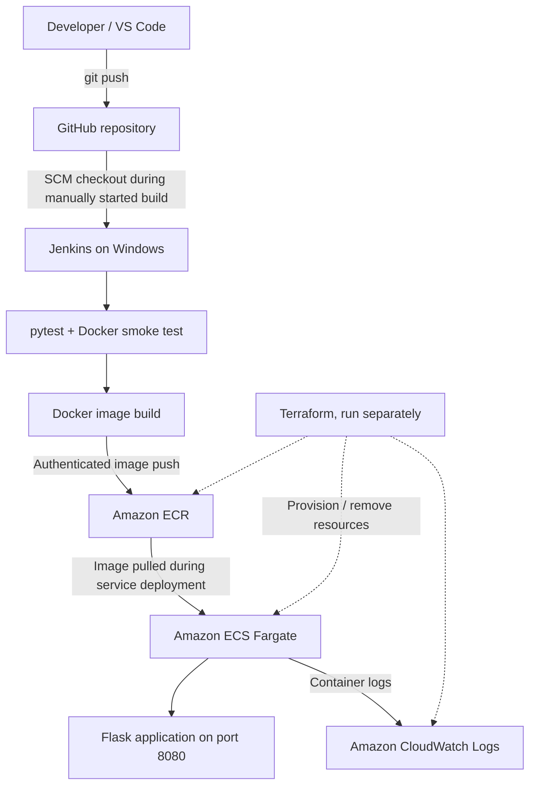

# Cloud Deployment Lab

**End-to-end CI/CD for a containerised Python application, deployed to AWS with infrastructure as code.**

**Stack:** Python · Flask · pytest · Docker · Jenkins · GitHub · Terraform · Amazon ECR · Amazon ECS Fargate · Amazon CloudWatch

> **Project status:** Working portfolio demonstration. The application has been deployed to AWS ECS, its `/health` endpoint tested successfully, and a parameterised Jenkins pipeline has completed successfully through the ECR/ECS deployment stage. The pipeline is started manually in Jenkins; this is **not** an always-on hosted demo or a GitHub webhook-triggered pipeline.


## Overview

Cloud Deployment Lab is a small Flask web application built to practise the **full delivery lifecycle** of a cloud-hosted container: writing code, running tests, building an image, publishing it to a registry, provisioning infrastructure, deploying a service and inspecting logs.

Rather than focusing on a complex application interface, this project focuses on **deployment automation, AWS access control and reproducible infrastructure**.

### What I implemented

- Created a Python/Flask application with a homepage, `/health`, and `/api/info` endpoints.
- Added three automated tests using `pytest` and an application health check.
- Containerised the application with Docker and ran a local container smoke test.
- Configured a parameterised **Jenkins declarative pipeline** that checks tools, verifies AWS access for deployment builds, runs tests, builds a Docker image, runs a container smoke test, and deploys when requested.
- Published the image to **Amazon ECR** and ran it as an **Amazon ECS Fargate** service in AWS Sydney (`ap-southeast-2`).
- Managed AWS resources using **Terraform** and configured a **CloudWatch Logs** log group.
- Separated an infrastructure-management AWS SSO profile from a restricted ECR/ECS deployment profile.

## Architecture



> **Deployment trigger:** Jenkins builds are currently launched from **Build with Parameters**. Selecting `DEPLOY_AWS` enables the ECR/ECS deployment stage. A successful source-code push alone does not trigger deployment.

## Repository structure

```text
cloud-deployment-lab/
├── app/                     # Flask application
│   ├── __init__.py
│   └── main.py
├── tests/                   # pytest tests
│   └── test_app.py
├── infra/                   # Terraform AWS infrastructure
│   ├── main.tf
│   ├── variables.tf
│   ├── versions.tf
│   └── outputs.tf
├── scripts/
│   └── deploy-aws.ps1       # Windows PowerShell ECR/ECS deployment
├── docs/
│   └── screenshots/         # Evidence of tested deployments
├── Dockerfile
├── Jenkinsfile
├── compose.yaml
├── requirements.txt
├── requirements-dev.txt
└── README.md
```

## CI/CD pipeline

| Stage | Purpose |
| --- | --- |
| Checkout SCM | Fetch the repository from GitHub |
| Verify Tools | Confirm Python, Docker and AWS CLI are available |
| Verify AWS Authentication | Check restricted AWS access for deployment-enabled builds |
| Install & Test | Install dependencies and run `pytest` |
| Build Docker Image | Create the application container image |
| Container Smoke Test | Verify the containerised application's health endpoint |
| Push to ECR & Deploy | With `DEPLOY_AWS=true`, push to ECR and request an ECS rolling deployment |


The deployment script uses a temporary Docker authentication configuration written as **UTF-8 without a BOM** to avoid a Windows credential-helper failure encountered while logging in to ECR. The configuration is deleted at the end of deployment. The lab currently uses a mutable `latest` image tag and an ECS forced deployment; immutable image tags and task-definition revisions are planned improvements.

## Run locally

**Requirements:** Python 3.12+, Git, Docker Desktop (Linux containers).

```powershell
# From the repository root
python -m venv .venv
.\.venv\Scripts\Activate.ps1
python -m pip install -r requirements-dev.txt
python -m pytest -v
python -m flask --app app.main run --port 5000
```

Then visit `http://127.0.0.1:5000/` or `http://127.0.0.1:5000/health`.

### Run with Docker

```powershell
docker build -t cloud-deployment-lab:local .
docker run --rm -p 127.0.0.1:8080:8080 cloud-deployment-lab:local
```

Visit `http://127.0.0.1:8080/health`. To use Docker Compose instead:

```powershell
docker compose up --build -d
docker compose down
```

## AWS infrastructure and deployment

**Requirements:** AWS CLI v2, Terraform, an AWS account with appropriate permissions, an ECR repository, and a configured AWS IAM Identity Center profile. These commands assume the Terraform configuration in `infra/` is unchanged from this project. **Review `terraform plan` before every apply.**

```powershell
# Infrastructure-management profile (not the restricted Jenkins role)
$env:AWS_PROFILE = 'cloud-lab'
aws sso login --profile cloud-lab

cd infra
terraform init
terraform validate
terraform plan
terraform apply
```

The initial Terraform configuration can create the shared resources without a running ECS service. After an image has been pushed to ECR, enable the service deliberately:

```powershell
terraform plan -var='enable_service=true'
terraform apply -var='enable_service=true'
```

Confirm the task is running in **ECS → cloud-lab → cloud-lab-service** and obtain its current public IP. The demo responds on `http://<task-public-ip>:8080/`. The public IP is **ephemeral** and should not be treated as a permanent project URL.

For Jenkins deployments, sign in with the separate, restricted SSO deployment profile (`cloud-lab-deploy`), then start a Jenkins **Build with Parameters** with `DEPLOY_AWS` checked. Jenkins must run under the Windows account that can use this SSO session. This is a **manually initiated**, session-dependent lab, not unattended production authentication.

### Shut down the running service

Fargate and public IPv4 usage can incur charges even when nobody is visiting the website. To disable the running service while retaining other infrastructure:

```powershell
$env:AWS_PROFILE = 'cloud-lab'
cd infra
terraform plan -var='enable_service=false'
terraform apply -var='enable_service=false'
```

Check ECS to confirm no task remains running. Some retained resources (including image storage) may still incur charges. Full cleanup can be done with `terraform destroy` **after reviewing the destroy plan**, as it can remove the ECR repository and other project resources.

## Test evidence

### Application and health endpoint

| Hosted application | Health endpoint |
| --- | --- |
|  |  |

The `/health` endpoint returned `{"status":"healthy"}` during the hosted test.

### Automated delivery


### Cloud infrastructure

| Container registry | ECS deployment |
| --- | --- |
|  |  |


### Logging, infrastructure as code, and testing

| CloudWatch log group | Terraform plan |
| --- | --- |
|  |  |


> The CloudWatch screenshot confirms the log group and log streams exist; it does not itself demonstrate an alerting rule or an incident-response workflow. The Terraform screenshot shows a no-change plan, confirming that the checked infrastructure matched configuration at that point in time.

## Challenges and what I learned

| Challenge | Approach / learning |
| --- | --- |
| Docker login failed on Windows | Identified a credential-helper error and used an isolated Docker configuration for ECR authentication. |
| Docker could not parse `config.json` | Fixed the UTF-8 BOM encoding issue by writing JSON as UTF-8 **without BOM**. |
| Terraform received `AccessDenied` errors | Separated administrator infrastructure access from the deployment-only IAM Identity Center permission set. |
| ECS public IP changed | Learned to locate the current running task's public IP after a replacement deployment. |
| Cloud resources may keep billing | Used Terraform's `enable_service` variable to disable the running Fargate service when testing was complete. |

## Security and limitations

- **No credentials committed:** IAM Identity Center SSO is used for local authentication. Docker's temporary ECR token configuration is removed after deployment.
- **Restricted deployment permissions:** Jenkins uses a deployment-specific permission set rather than the Terraform administrator profile.
- **HTTP demonstration only:** The public demo uses plain HTTP on port 8080 and does **not** include TLS, a stable domain, a load balancer or end-user authentication. Do not send sensitive data to it.
- **Manual build trigger:** There is no GitHub webhook or automatic build trigger configured in the documented workflow.
- **Basic observability:** CloudWatch log collection is configured; dashboards, production alerting and incident automation are not claimed.
- **Mutable image tag:** Deploying `latest` is sufficient for this exercise but less reproducible than deploying immutable commit-based image tags.

## Next improvements

- [ ] Tag ECR images using the Git commit SHA and deploy an exact task-definition image revision.
- [ ] Add HTTPS and a stable endpoint behind an Application Load Balancer if a persistent public service is needed.
- [ ] Add CloudWatch alarms and demonstrate an incident/rollback scenario.
- [ ] Add a GitHub-triggered build mechanism with secure credentials for unattended automation.
- [ ] Add image vulnerability checks and dependency scanning.
- [ ] Improve Terraform state management and module structure.

---

**Built as a hands-on cloud engineering portfolio project.** The focus is on understanding the deployment lifecycle, access control, troubleshooting and cost-aware infrastructure management.
